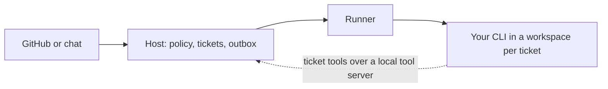
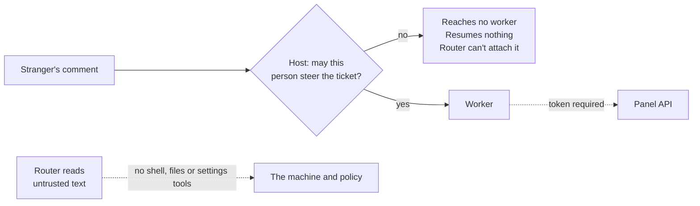

<div align="center">

# Super-agent 2.0

**An always-on coding agent for GitHub and chat. Bring any coding-agent CLI. Runs on your machine.**

Super-agent listens to GitHub and chat, turns requests from people you authorize into tickets, and runs each one in its own workspace with the agent CLI you choose: Claude Code, Codex, Gemini CLI, OpenCode, or any other. It is built to stay safe while reading text from strangers, even if the model is fooled.

> **Today it only works inside the DeepSeek Harness UI.** Making it standalone, with no DeepSeek software and any CLI you like, is the main thing we're building. See the [roadmap](#roadmap).

[](LICENSE)

[Updates](#updates) · [Any CLI](#standalone-with-any-cli) · [Roadmap](#roadmap) · [Why this exists](#why-this-exists) · [Status](#project-status) · [Fixed so far](#fixed-so-far) · [Still open](#still-open-and-how-were-fixing-it) · [Contribute](#contributing)

</div>

> [!NOTE]
> **This is a community fork of [deepseek-ai/dsh-superagent-prototype](https://github.com/deepseek-ai/dsh-superagent-prototype), the reference code for DeepSeek's Super-agent design.** It's independent and not affiliated with or endorsed by DeepSeek. "2.0" is our name for this effort, not an official successor.

> [!WARNING]
> **Don't run this on a repository or machine you care about yet.** Workers still run unconfined as your OS user ([SEC-01](ISSUES.md#sec-01-workers-run-unconfined-as-the-operators-os-user)). We have blocked several paths at the host, but this is not secure until the P0 items below are closed.

## Updates

**2 November 2026**

- **A plain Node host.** The engine, the management API and the Sources now run in one Node process with no DeepSeek software at all: `pnpm start`. The engine no longer depends on the harness, so the host and the agent runner are separate pieces and either can be replaced on its own.
- **Claude Code runs a ticket.** The agent CLI is behind a runner of its own, and the engine's tools reach it over an MCP server the engine serves. The router, which reads text from strangers, runs with the CLI's built-in tools taken away, and the runner checks the CLI's own report of what it has and refuses it if anything else is there.
- **Ports in place.** The agent runner, host and model services now sit behind interfaces in `src/runner/port.ts`. DeepSeek Harness is the only implementation so far, and nothing about how it behaves changed. This is the seam that lets other runtimes plug in.
- **A standalone panel.** The management UI in `desktop/` runs on its own, without the DeepSeek sidebar. It needs a running service for its data. Start it with `pnpm ui:dev`.
- **Checked the agent CLIs.** We tried Claude Code, Codex, Gemini CLI and OpenCode for headless runs, session resume and removing built-in tools. Claude Code can run with no built-in tools, so it's the first CLI allowed to read strangers' text. For the other three, resume looks possible, but the tool-removal and tool-server setup still need testing.
- **Checked the desktop webview.** The Tauri webview reaches the management API only if the API allows one extra origin, `tauri://localhost`. We'll add that as an option the desktop app turns on.
- **Test with one account.** A new off-by-default `receiveOwnIssues` switch lets the agent receive Issues from its own GitHub account, so you can try it without a second account. Its own comments and pull requests are still ignored.
- **Tests.** 1,230 pass.

Earlier: five weaknesses in the attack path were fixed at the host (see [fixed so far](#fixed-so-far)).

## Standalone, with any CLI

The original only works as a plugin inside DeepSeek Harness (DSH). DSH loads it, shows its panel in the DSH sidebar, runs its agent sessions and work tools, and signs in to a DeepSeek model. We're changing that:

- **No DeepSeek software needed.** A plain Node host and our own panel, then a desktop app (Tauri, macOS first). The host is built; the CLI behind it is next.
- **Any CLI, per role.** You pick which coding-agent CLI does each job. We don't ship a model or an agent loop.
- **Local first.** It runs on your machine against your repositories. Nothing is hosted.
- **The same safety rules.** The host enforces the limits, whichever CLI is behind them.



| CLI | As a worker | As the router |
|---|---|---|
| Claude Code | Works | Works: runs with no built-in tools (checked) |
| Codex | Planned | Not verified yet |
| Gemini CLI | Planned | Not verified yet |
| OpenCode | Planned | Not verified yet |
| Any other CLI | Through a command template | Only if the host can verify it has no built-in tools |

The Claude Code adapter is written; the others are the plan.

The router reads text from strangers, so it's the role to protect. The host refuses a CLI there unless it can confirm the CLI runs with only our routing tools and no shell or file access. A CLI that can't prove that can still be a worker.

## Roadmap

| Step | State |
|---|---|
| Ports between the engine and DSH | Done |
| Standalone panel UI | Done; needs a running service |
| Plain Node host that replaces DSH | Done; runs the panel, the Sources and the agent CLI |
| CLI runners: Claude Code first, then Codex, Gemini CLI, OpenCode and a command template | Claude Code done; the others planned |
| Sandbox for workers ([SEC-01](ISSUES.md#sec-01-workers-run-unconfined-as-the-operators-os-user)) | Planned |
| Tauri desktop app with a setup wizard | Later |

## Why this exists

The original repository [has issues, pull requests and discussions turned off](https://github.com/deepseek-ai/dsh-superagent-prototype) (checked through the GitHub API on 2 November 2026), so problems can't be reported or fixed there. **So we forked it, and we're fixing them here, in the open.** This is the same Super-agent code, with our changes on top.

If you've read the article and want to work on the Super-agent, you can do that here: open an issue, send a pull request, or pick up an item from the backlog.

The original is a good design and a fair starting point. Its [article](https://x.com/DeepSeekHarness/status/2116857257245987236) calls the code a research prototype and names security and privacy as an open problem. This project takes that problem on.

## The goal

An agent that can read a hostile comment and still do no harm, because the system's limits hold **even if the model is fully fooled**.

Prompts can ask a model to behave, but only the host can enforce it. We hold ourselves to three rules:

1. **Security: assume the model is compromised.** Authority comes from code, never from text the model read.
2. **Error handling: failures are typed, bounded and visible.** Nothing retries forever or fails silently.
3. **Communication: anyone authorized who asks gets an answer.** Accepted, declined or failed comes from the host, not from a model choosing to mention it.

## Project status

| | |
|---|---|
| **Fixed at the host** | 5 weaknesses in the attack path, covered by [tests](tests/attack-chain.spec.ts) |
| **Open** | [54 items](ISSUES.md): 5 P0, 19 P1, 18 P2, 12 P3 |
| **Tested with** | The real gate, tools and HTTP routes on a fake harness with no model |
| **Standalone** | The panel UI and a plain Node host run on their own. The agent CLI runners and the desktop app are not built yet ([roadmap](#roadmap)) |
| **Not yet tested** | The real harness, or any real model following an injected comment ([SEC-04](ISSUES.md#sec-04-prove-or-disprove-the-attack-end-to-end)) |

We haven't shown this attack working end to end. The tests prove what the host allows or refuses, not how a model behaves. We will publish results per model once the red-team run exists.

## Fixed so far



| Problem in the original | What we changed | Proof |
|---|---|---|
| A stranger's comment reached a live worker | The host decides who may steer a ticket; everyone else's message reaches no worker | [`attack-chain`](tests/attack-chain.spec.ts) |
| A stranger's comment resumed an ended ticket, with no evaluation | Only authorized people can resume work | [`attack-chain`](tests/attack-chain.spec.ts) |
| The router read untrusted text and had a shell, file reads and background jobs | The router has only its routing tools and skills | [`bundle-patch`](tests/bundle-patch.spec.ts) |
| The router could change the allowlist, accept mode and prompts | Those tools are gone; changes go through the panel | [`attack-chain`](tests/attack-chain.spec.ts) |
| One fixed header let any local process rewrite settings, including a shell command | The panel API requires a bearer token from a `0600` file | [`attack-chain`](tests/attack-chain.spec.ts) |

**Two limits on these fixes:**
- Until workers are isolated, a compromised worker shares your OS user, so it can still read the token and the database. It can also still read hostile text through `gh`, where only a prompt rule stops it obeying.
- Comments from unlisted people, including human reviewers, no longer reach workers. Add your reviewers to the allowed list.

## Still open, and how we're fixing it

Each item in [ISSUES.md](ISSUES.md) has evidence, a failure scenario, acceptance criteria and a size, so a person or a coding agent can pick it up alone.

### P0: required before calling this secure

| ID | Issue | How we're fixing it |
|---|---|---|
| SEC-01 | Workers run unconfined as your OS user | One container or microVM per ticket, with only its checkout, a separate user and no home directory |
| SEC-02 | Long-lived credentials are within a worker's reach | Short-lived, single-repo GitHub App tokens, added by a proxy so the model never holds them |
| SEC-03 | Untrusted PR code and instructions may run with full access | Sandbox outside code with no credentials or network, and load `AGENTS.md` from the default branch only |
| SEC-04 | The attack hasn't been proven end to end | A repeatable red-team run with canary secrets, reported per model |
| SEC-05 | Workers can rewrite the control plane through the filesystem | Separate the host and workers, and keep the database and token out of reach |

### P1: required for a credible release

**Security**

| ID | Issue | How we're fixing it |
|---|---|---|
| SEC-06 | Workers read untrusted text with no host-level marking | Label trust on every read, and require approval for risky actions after reading untrusted text |
| SEC-07 | No secret scanning or limits on outgoing data | Scan messages and pushes, and enforce a network allowlist |
| SEC-08 | Removing someone's access doesn't stop their work | Revalidate on every policy change, and stop or pause affected tickets |
| SEC-09 | Merge and branch safety rely on prompts | Check branch protection at setup, and refuse merges and out-of-scope pushes at the broker |
| SEC-10 | Deeply nested subagents may escape tool limits | Fail closed: no resolved ancestry means no tools, with a depth cap |
| SEC-11 | Worker reports pass unbounded text to the router | Cap length, mark as untrusted, and redact command output |

**Communication**

| ID | Issue | How we're fixing it |
|---|---|---|
| COM-01 | A timed-out evaluation is never reported to the requester | The host sends a templated failure reply, once per message |
| COM-02 | Failure notices depend on the router choosing to send them | The host sends them, and the router may add detail |
| COM-03 | Requests the host refuses get silence | An optional, rate-limited fixed reply, off by default on public repos |

**Error handling and reliability**

| ID | Issue | How we're fixing it |
|---|---|---|
| ERR-01 | Errors are classified by searching their text | A typed error model with kind, retryable flag, owner and a safe message |
| ERR-02 | Stored work retries forever, and one bad relay blocks the rest | A dead-letter state, operator notice and requeue from the panel |
| REL-01 | Restart recovery relies on the model not repeating actions | Idempotency keys and an action log at the broker |
| CAP-01 | No real Watchdog | A separate non-LLM supervisor with fixed rules; the LLM only helps diagnose |

**Cost, testing and project**

| ID | Issue | How we're fixing it |
|---|---|---|
| COST-01 | No per-ticket limits on spend, time or turns | Hard caps enforced by the host, with a templated stop message |
| COST-02 | No rate limit on incoming events | Per-thread and per-sender limits before any model call, plus a circuit breaker |
| TEST-01 | Nothing tests against the real harness | A smoke test that boots the real harness with a fake model |
| TEST-02 | No CI or security regression gate | CI that runs checks, a dependency audit and the attack tests |
| PKG-01 | The code and package still use the original name | Rename to `super-agent-2`, keeping the MIT notice and the unaffiliated line |
| DOC-01 | No threat model or security policy | A `SECURITY.md` covering what is and isn't protected |

### P2 and P3

Thirty more items cover misleading errors, data retention, cleanup, webhooks, multi-repo support, the article's cloud and daemon design, and code quality. See [ISSUES.md](ISSUES.md).

## What's worth keeping from the original

The architecture is why this project exists: a long-lived router with isolated workers, thread subscriptions, two-stage event filtering, on-demand context recall, a durable outbox and the mandate model. Its 1,197 tests also gave us a solid base to change things safely.

## Try it

Only in a disposable environment, with a throwaway GitHub account, a private test repository and a spend-limited API key.

```bash
git clone https://github.com/abubakarsiddik31/super-agent-2
```

```bash
cd super-agent-2 && pnpm install && pnpm check
```

**The standalone host.** This runs the engine, the management API, the Sources and the agent CLI in one Node process, with no DeepSeek software:

```bash
pnpm start --cli claude
```

It listens on the loopback interface and prints the port it chose. The state directory (by default `~/.dsh/state/superagent`) holds the database, the worker shims and the panel token. `--state-dir`, `--port`, `--cli` and `--cli-model` change where it runs and which CLI it drives. Without `--cli`, the panel and the Sources still run, and a ticket that needs an agent fails with a message that says so.

**The standalone panel.** With the service running, this serves the new UI on its own, without the DSH sidebar:

```bash
pnpm ui:dev
```

Then open http://localhost:5273. The dev server forwards the API to `http://127.0.0.1:3082` and adds the panel token itself, so the browser never holds it. Set `SUPERAGENT_API` or `SUPERAGENT_TOKEN_FILE` to point it elsewhere.

**Inside the DeepSeek Harness.** The original plugin still works, and still runs agents the DeepSeek way. To run it that way, ask a coding agent to follow [SETUP.md](SETUP.md). The code and commands still use the name `dsh-superagent`, and the management API needs the token described in [the deployment guide](docs/006-deployment.md).

## Documentation

Read in order; each builds on the ones before it.

- [000 Philosophy](docs/000-philosophy.md)
- [001 Domain model](docs/001-domain.md)
- [002 Authorization](docs/002-authorization.md)
- [003 Execution](docs/003-execution.md)
- [004 Prompts](docs/004-prompts.md)
- [005 Panel](docs/005-panel.md)
- [006 Deployment](docs/006-deployment.md): manual setup, configuration, upgrades and troubleshooting
- [007 Architecture](docs/007-architecture.md)
- [008 Cookbook](docs/008-cookbook.md): adding a Source

## Contributing

Issues and pull requests are open.

1. Pick an item in [ISSUES.md](ISSUES.md) and check its dependencies.
2. Keep to one item per pull request, and meet its acceptance criteria.
3. Run `pnpm check`. New test files must be listed in [docs/007-architecture.md](docs/007-architecture.md).
4. Use harmless marker text in tests, never working injection payloads or real credentials.

**Found a vulnerability?** Please report it privately through [GitHub's security advisories](https://github.com/abubakarsiddik31/super-agent-2/security/advisories/new), not in a public issue.

## License and credit

[MIT](LICENSE). The original copyright notice stays in place. The architecture and the original code are the work of the DeepSeek Harness Team; the changes in this repository are ours, and any mistakes in them are ours too.
